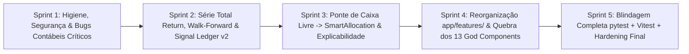

# Plano de Arquitetura, Integridade Financeira e Motor de Sinais Estatísticos v2 — AssetFlow

**Data da Auditoria:** 2026-11-24  
**Modo de Execução:** Auditoria Completa Somente-Leitura (nenhum arquivo de código-fonte alterado nesta etapa)  
**Papel:** Principal Software Architect & Quantitative Systems Engineer  

---

## 0. Norte do Produto — Escopo Oficial (3 Pilares Integrados Inegociáveis)

O AssetFlow é um hub financeiro pessoal composto por **3 pilares integrados**, todos obrigatórios e preservados integralmente na arquitetura-alvo:

1. **Pilar 1 — Fluxo de Caixa & Liquidez:**
   - **Agenda de Dividendos** (`app/agenda/`): previsão, calendário, extrato histórico, analytics, sazonalidade e Yield on Cost.
   - **Contas a Receber / Empréstimos** (`ReceivablesTab`, `ReceivablesModals`): devedores, parcelas, pagamentos parciais/cascata e fechamentos mensais.
   - *(Decisão do usuário em 2026-11-24: o módulo de Cartões de Crédito & Extratos foi removido do escopo em vez de ajustado.)*
2. **Pilar 2 — Controle de Carteira & Fiscal:**
   - Ações, FIIs, Renda Fixa (`FixedIncomeTab` com MTM Tesouro Direto e curva CDI/IPCA/PRE), ETFs/Exterior, Cripto e Reserva.
   - Preço médio, eventos corporativos (`SPLIT`, `INPLIT`, `BONUS`, `SPIN_OFF`, `TICKER_CHANGE`, `AMORTIZATION`) e Histórico/Auditoria de Emissões (`CorporateActionGlobalModal`).
   - Evolução patrimonial (`evolution/`: TWR, MWR/XIRR, atribuição de performance, snapshots) e suporte fiscal mensal/anual (`tax/`: DARF e IRPF).
3. **Pilar 3 — Motor de Pontos de Compra e Recomendações (Diferencial Central):**
   - Recomendações baseadas em **análises quantitativas e fundamentalistas validadas historicamente via Backtest Walk-Forward**, com **probabilidade calibrada de acerto (`wilson_lower_bound`, Regime Macro e Brier Score)**, conectadas diretamente à disponibilidade projetada de caixa (**Ponte de Caixa Livre 30d**) e às metas da carteira (`SmartAllocationModal`).

---

## 1. Boletim Revisado (Notas 0–10 com Evidências `arquivo:linha`)

| Dimensão Auditada | Nota | Diagnóstico Executivo e Evidências Verificadas (`arquivo:linha`) |
|---|---:|---|
| **Backend (`server/`)** | **6.4 / 10** | Boa organização inicial em 26 blueprints (84 rotas HTTP), `domain/` e `services_modules/`, porém comprometida por **5 implementações divergentes de replay contábil de `AssetTransaction`** (`services_modules/portfolio.py:353-378`, `domain/portfolio/monthly_snapshot.py:217-246`, `routes/portfolio.py:118-135`, `domain/tax/annual_irpf.py:70-95`, `routes/assets.py:332-349`), I/O síncrono pesado dentro de requisições HTTP (`routes/dividends.py:414-422`, `routes/quant_analysis.py:417-564`), invalidação de cache com nomes de chaves errados (`services_modules/cache_helper.py:33-46` apaga `"correlation_matrix_cache_{uid}"` enquanto `facades.py:48` grava `"correlation_matrix_{uid}"`) e crash latente do worker em `server/Dockerfile:62` (`CMD ["python", "-m", "worker.worker"]` vs imports relativos `from worker_state import ...` em `server/worker/worker.py:26`). |
| **Frontend (`app/`)** | **6.8 / 10** | Uso correto de `dynamic()` em `DashboardTabContent.tsx`, suporte amplo a `PrivacyContext` (`usePrivacy().isHidden`) e bom modelo modular em `AssetRow.tsx` (`asset-row/`). Porém sofre com **13 God Components acima de 25 KB** (`QuantDashboard.tsx` com 68.5 KB / 1.222 linhas; `ReceivablesTab.tsx` com **39 `useState`** em 1.132 linhas), fronteiras de domínio dispersas (`CreditCardsTab`, `StatementImportModal` e `FixedIncomeTab` em `app/components/`, `receivables/` dentro de `app/features/assets/tabs/`), import eager de `MorningBriefing` (`DashboardTabContent.tsx:13`) e classes raw `slate-*` / `bg-[#0b0f19]` remanescentes (`AssetNewsPanel.tsx:103-192`, `AssetRecommendationCell.tsx:35-56`, `StatementImportModal.tsx`, `CorporateActionGlobalModal.tsx:590-670`). |
| **Banco de Dados & Migrations** | **6.2 / 10** | SQLite em modo WAL + uso de `Numeric(18, 4)` na maior parte dos valores monetários e constraints da Rodada 2 (`_user_date_snapshot_uc`), mas com **drift grave entre ORM e Alembic**: `monthly_portfolio_snapshot` (`db/models/portfolio.py:158`) **não tem migration Alembic** (criada via `create_all`); `_dividend_unique_uc` declara `date_com` no model (`portfolio.py:136`) mas a migration `c09ce9bdd397_add_corporateevent_and_dividend_type.py:53` foi criada **sem `date_com`**; `market_data` deleta todo histórico mantendo 1 linha por ativo (`market_data.py:189-194`); faltam índices de FK (`payment_transactions.installment_id`, `loan_installments.loan_id`, `receivable_loans.debtor_id`, `card_expenses.card_id`, `card_installments.expense_id` em `db/models/financials.py`); arquivo sombreado morto `server/db/models.py`; recursão infinita em `safe_drop_table`/`safe_drop_index` em `70c6edf66856_initial_schema.py:377-385`. |
| **Fluxo de Caixa (Agenda / Cartões / Recebíveis)** | **5.5 / 10** | Fluxos completos em escopo, mas afetados por erros contábeis severos: **divisão inteira `Decimal // int`** truncando parcelas para reais inteiros (`routes/credit_cards.py:196-197` e `routes/statement_import.py:107-108`); vencimento gerado **antes da compra** quando `due_day < closing_day` (`utils/date_helper.py:5-25`); `statement_import.py` sem deduplicação, gravando PIX recebido/pagamento de fatura como gasto (`statement_parser.py:343,420`) e sobrescrevendo datas `DD/MM/YYYY` com `datetime.now()` (`statement_import.py:88-90,138-153`); coleção ORM `inst.transactions` defasada deixando empréstimos quitados como `PENDENTE` (`routes/refunds/payments.py:24-65,86-96`); `calendar.py:56-63` calculando proventos futuros sobre `pos.quantity` atual em vez de `date_com`; e `integration.py:138,203-209` inventando `d_com + 15d` e marcando `PAGO` sem pagamento. |
| **Motor Quant & Sinais** | **4.2 / 10** | Boas travas determinísticas em `calculator.py` (Gordon/DCF `g >= k`, gate `4/6` e `3/4`, veto caro em `dashboard_metrics.py:259-262`), mas **estatisticamente inválido como motor preditivo**: (1) Backtest de `SignalsBookView` (`routes/valuation.py:380-403`) lê `MarketData` que só tem 1 linha (`hoje`), fazendo `30d`, `90d` e `180d` retornarem o **mesmo retorno acumulado**; (2) Todo o módulo `domain/quant/*` usa `"Close"` com `auto_adjust=False` (`price_cache.py:108`, `helpers.py:136`) contra `^BVSP` Total Return; (3) `rsi_14` e `sma_20` nunca são gravados em `MarketData`, travando RSI em `50.0` (`dashboard_metrics.py:103-124`) e `above_sma_pct = 100%` no Fear & Greed (`quant_analysis.py:315-322`); (4) Ausência de fundamentos point-in-time (`filing_date`), survivorship bias, tripla contagem de valuation e ausência de `win_rate`, `wilson_lower_bound`, corte `N >= 20`, Walk-Forward, Regime e Brier Score. |
| **Segurança & Isolamento Multiusuário** | **6.0 / 10** | Cookie assinado e validações básicas presentes, mas com **lacunas de isolamento `user_id`** em `SignalSnapshot` (`dashboard_alerts.py:198-206`), `TriggeredAlert` (`backup.py:36-44`), `selectinload(Asset.dividends)` (`db/models/base.py:35-36`), `worker_jobs.py:69-88`, `Category.target_percent` global (`maintenance.py:11-20`), `telegram_config` global (`alerts.py:298-320`) e `ScheduledJob` editável por qualquer autenticado (`scheduler.py:82-188`); `X-Forwarded-For` falsificável burlando rate-limit (`auth.py:18-22`); endpoint público `/api/assets/icon/<ticker>` (`backend.py:116-117`, `assets_icon.py:204-266`) sujeito a DoS de disco e SVG same-origin; ausência de `MAX_CONTENT_LENGTH` (`backend.py:83-96`) e logout sem revogação server-side (`auth.py:209-213`). |
| **Testes Automatizados** | **5.8 / 10** | Há **31 suítes backend (`164` testes)** e **16 suítes frontend (`59` testes)**, mas com concentração em mocks (`MagicMock`) e **zero cobertura** nos pontos mais frágeis: `INPLIT`, `AMORTIZATION`, `SPIN_OFF`, `TICKER_CHANGE` e leilão de frações; `Decimal // int` e `due_day < closing_day`; `import-batch` + `dedup.py` recorrente; `refunds/payments.py` (transição `LIQUIDADO`); compra pós-`date_com` na agenda; e qualquer cálculo estatístico/backtest do Motor de Sinais. |

---

## 2. Auditoria Completa da Fase 1 (`server/`) e Integridade Financeira

### 2.1 Cruzamento com Auditorias Anteriores em `.agents/tasks/`

- **`validacao-indicadores-e-ia.md`**:
  - *Resolvido:* AI tilt removido de `rebalance.py:120`; modulador AI travado em `+4/-6` sem cruzar cortes `55/60` (`dashboard_metrics.py:201-212`); flags `dy_includes_amortization`/`dcf_is_estimate` (`screener_service.py:278-310,364`); Gordon restrito a `Ação` e `magic_number` restrito a `FII`; gate `4/6` e `3/4` no checklist (`calculator.py:271-282`); `ai_status="error"` em falha de JSON (`gemini_service.py:256-265`).
  - *Aberto / Regredido:*
    - **Regressão em `I1` (Amortização FII):** `collect_amortization_12m_map` (`server/infrastructure/market_data.py:124-133`) soma `tx.unit_price` (**o novo Preço Médio após amortização**, ex.: R$ 98,50) como se fosse a amortização por cota (`tx.total_value / tx.quantity`, ex.: R$ 1,50), zerando completamente `dy_12m` e `bazin_price` do FII!
    - **Regressão parcial em `I10` (VPA com milhar):** corrigido em `screener_service.py:503-506`, mas **permanece quebrado** em `market_data.py:146` (`_extract_vpa_from_report_json` ainda executa `.replace(",", ".")` sem remover pontos de milhar).
    - **Itens `A8`, `A9`, `A10`, `A11` abertos:** `@with_safe_commit` em `/api/ai/chat` (`routes/ai.py:396`) pode duplicar linhas de histórico em retry; histórico Gemini sem limite de janela (`ai.py:418,523`); `/api/ai/explain-score/<ticker>` sem cache (`ai.py:622-668`); worker de sentimento rodando globalmente cross-tenant (`worker_jobs.py:121-150`).
- **`auditoria-rodada-2.md`**:
  - *Resolvido:* `delete_transaction` inclui os 4 eventos corporativos (`D1`); `update_position` gera ledger `ADJUSTMENT`/`DEPOSIT`/`WITHDRAW` (`D2`); SQLite `.backup()` API (`D3`); constraint `_user_date_snapshot_uc` (`D4`); preservação de `min_6m` (`D5`); `pwd_sig` parcial (`S1`); rate-limit apenas em falhas (`S2`); `get_current_user_id()` sem fallback silencioso (`S3`); `/api/sync/stream` protegido (`S4`); `joinedload` em dividendos (`P2`).
  - *Ainda aberto:* `get_active_positions` carrega `selectinload(Asset.dividends)` em 18 de 19 chamadas sem filtrar `user_id` (`db/models/base.py:17,35-36`); sobra de `yf.Ticker().fast_info` síncrono em `routes/dividends.py:58-62` (`P6`); recomputação redundante de `calculate_monthly_attribution` em `/api/performance/returns` (`xirr.py:373`); logout sem revogação server-side; `X-Forwarded-For` confiável sem `ProxyFix`.
- **`importacao-extrato-cartao.md`**: implementação funcional no fluxo básico, porém com bugs severos de centavos (`//`), datas `DD/MM/YYYY`, ausência de deduplicação, importação de créditos positivos e falha em `.docx`/`.xlsx`.
- **`verificacao-evolucao-e-preco-medio.md`**: alinhamento diário e cálculo do mês vivo corrigidos em `monthly_snapshot.py:362-379,538-548`, mas ainda há divergências críticas em `BONUS`/`SPIN_OFF` no `annual_irpf.py` e no replay de leilão de frações.

### 2.2 Mapa Consolidado de Domínios, Tabelas (30 ORM Models) e Rotas (26 Blueprints / 84 Endpoints)

| Pilar | Tabelas (`server/db/models/`) | Escopo `user_id` | Blueprints e Principais Rotas (`server/routes/`) |
|---|---|---|---|
| **1. Fluxo de Caixa & Liquidez** | `dividends` (`portfolio.py:116`), `credit_cards` (`:148`), `card_expenses` (`:165`), `card_installments` (`:184`), `refund_configs` (`:6`), `debtors` (`:15`), `receivable_loans` (`:89`), `loan_installments` (`:113`), `payment_transactions` (`:135` em `financials.py`) | Todas têm `user_id` (via FK nas tabelas pai) | `calendar.py` (`GET /api/calendar`); `dividends.py` (`POST /api/dividends`, `/history`, `/yoc`, `/analytics`, `/yoc-history`, `/seasonality`); `credit_cards.py` (`CRUD /api/credit-cards`, `/<id>/invoices`, `/<id>/expenses`, `/installments/<id>/pay`, `/dashboard`); `statement_import.py` (`/api/statements/parse`, `/import-batch`); `categorize.py` (**morto**); `refunds/{config,debtors,loans,payments,dashboard}.py` (`/api/refunds/*`) |
| **2. Carteira, Eventos & Fiscal** | `categories` (`:6`), `assets` (`:13`), `positions` (`:41`), `asset_transactions` (`:67`), `corporate_events` (`:95`), `snapshots` (`:139`), `monthly_portfolio_snapshot` (`:158`), `fixed_income` (`financials.py:203`), `tax_profiles` (`auth.py:29`) | `categories` e `assets` são **globais**; demais têm `user_id` | `dashboard.py` (`/api/index`, `/api/history`); `assets.py` (`/api/assets`, `/add_asset`, `/update_asset`, `/delete_asset`, `/asset-transactions*`, `/refresh_prices`, `/corporate-action`, `/emissions*`); `fixed_income.py` (`/api/fixed-income*`, `/tesouro-direto`); `portfolio.py` (`/api/portfolio/monthly-evolution`, `/recalculate-history`, `/export-history`, `/import-history`, `/api/performance/{attribution,returns}`); `ocr_import.py` (`/api/ocr/parse-*`); `tax.py` (`/api/tax/{monthly,profile,annual}`); `simulation.py` (`/tax-thermometer`, `/sell`); `maintenance.py` |
| **3. Motor Quant, Valuation & Sinais** | `market_data` (`system.py:12`), `market_screener_items` (`valuation.py:16`), `watchlist_items` (`valuation.py:104`), `signal_snapshots` (`portfolio.py:183`), `price_alerts` (`system.py:41`), `triggered_alerts` (`system.py:102`) | `market_data` e `market_screener_items` globais; demais têm `user_id` | `valuation.py` (`/api/valuation/{asset/<t>,radar,radar/refresh,compare,watchlist*,passive-income,signals/history}`); `quant_analysis.py` (`/api/quant/{kelly-criterion,attribution-analysis,rebalance-bands,dca-lump-sum,efficient-frontier,sharpe-rolling,momentum-ranking,fear-greed,reports,generate-report}`); `simulation.py` (`/optimize`, `/risk-parity`, `/exposure`, `/correlation`); `assets.py` (`/api/risk-metrics`, `/api/smart-rebalance`); `dashboard.py` (`/api/simulation`, `/update-fundamentals`, `/sync-reports`); `market.py` (`/api/market/indices`); `alerts.py` & `alerts_price.py` (`/api/alerts*`, `/api/price-alerts*`) |
| **Transversal (Auth / Worker / IA)** | `users` (`auth.py:6`), `ai_chat_histories` (`system.py:90`), `audit_logs` (`system.py:31`), `sync_states` (`system.py:57`), `system_caches` (`system.py:67`), `scheduled_jobs` (`system.py:117`) | `audit_logs`, `sync_states`, `scheduled_jobs` globais | `auth.py` (`/api/auth/*`); `scheduler.py` (`/api/scheduler/jobs*`); `health.py` (`/api/health`); `sync_stream.py` (`/api/sync/stream`); `ai.py` (`/api/ai/{chat,history*,explain-score/*}`); `news.py` (`/api/news/<t>`) |

### 2.3 Auditoria de Séries Históricas: Dividendos, JCP, Splits, Inplits e Bonificações

| Ponto de Chamada (`arquivo:linha`) | Função / Consumidor | Parâmetro `auto_adjust` & Coluna | Ajuste de Divs/JCP | Ajuste de Splits/Bonificações | Achado |
|---|---|---|---|---|---|
| `server/infrastructure/price_cache.py:106-110` | `fetch_price_history` (usado por todo `domain/quant/*`, `quant_analysis.py:154`, `xirr.py:192`) | `auto_adjust=False`; armazena OHLCV + `Adj Close` | **NÃO** (`helpers.py:136` extrai `"Close"` e descarta `"Adj Close"`) | Apenas splits Yahoo; ignora `BONUS` B3 | **CRÍTICO:** Quedas ex-div/JCP viram perdas de capital contra `^BVSP` Total Return. |
| `server/infrastructure/market_data.py:178` vs `:209` | `update_prices` → `MarketData` | Batch (`:178`): `auto_adjust=False`; Fallback (`:209`): `Ticker.history(period="6mo")` (`auto_adjust=True`) | Batch **NÃO** / Fallback **SIM** | Splits Yahoo | **INCONSISTÊNCIA:** Mistura `min_6m` e `change_pct` ajustados vs nominais. |
| `server/routes/valuation.py:380-404` | `signal_history` (`SignalsBookView`) | Lê `MarketData.price` (`today` único) vs `SignalSnapshot.preco` | **NÃO** | **NÃO** | **CRÍTICO:** Backtest com 1 única data e sem ajuste de eventos/proventos. |
| `server/domain/quant/risk.py:95-98` | Filtro de split no cálculo de risco | `bad_mask = (ratio < 0.5) \| (ratio > 2.0)` + `.ffill()` | **NÃO** | Mascara só 1 dia `t` | **BUG:** O degrau completo do split reaparece em `t+1` no `log_ret`. |
| `server/domain/portfolio/monthly_snapshot.py:136-186` & `dividends.py:414-466` | `build_historical_price_cache`, `_get_dividend_market_prices` | `auto_adjust=False, actions=True` + reversão por `Stock Splits` | **NÃO** (intencional nominal) | Reverte splits para casar com qty da época | Correto para patrimônio nominal (dividendos entram separados), mas frágil se houver `BONUS` B3 ausente no Yahoo. |
| `server/infrastructure/screener_service.py:222-228` | `fetch_ticker_fundamentals` fallback | `yt.history(period="5d")` (`auto_adjust=True`) | **SIM** | **SIM** | Seguro para cotação spot recente. |
| `server/routes/market.py:115-123` | `update_market_cache` (índices macro) | B3 MDS direto para `IFIX`; `yf.download` para `^BVSP`/EUA/FX/BTC | `^BVSP` e `IFIX` já são Total Return | Sim | Consistente após correção do `IFIX`. |

### 2.4 Bugs Matemáticos, Contábeis e Fiscais por Área (`arquivo:linha`)

1. **Preço Médio & Eventos Corporativos (`services_modules/portfolio.py`, `market_data.py`, `annual_irpf.py`):**
   - `SPIN_OFF` (`portfolio.py:510-559`): subtrai `pos.quantity * cost_transfer` da controladora, mas atribui `received_qty * cost_transfer` à cindida; quando `received_qty != pos.quantity`, cria ou destrói custo contábil (ex.: 100 ações → 20 cindidas perde 80% do custo transferido).
   - Leilão de frações (`portfolio.py:468-501`, `tax_engine.py:99`): `SPLIT`/`INPLIT`/`BONUS` grava `quantity = floor(new_qty)` **e** cria um `SELL` da fração — todo replay subsequente subtrai a fração **duas vezes**; além disso `sell_tx` fica com `cost_basis = None`, tributando 100% de `auction_value` como lucro no DARF; quando `auction_value == 0`, a fração é descartada sem redistribuir seu custo às cotas restantes.
   - `annual_irpf.py:70-95`: `_get_bens_e_direitos` executa `pos["quantity"] += tx.quantity` em `BONUS` (dobrando a posição porque `tx.quantity` guarda o novo total!), ignora `unit_cost` atribuído pela RFB (`total_value = 0`) e **não trata `SPIN_OFF` no loop** (duplicando custo entre mãe e filha).
   - Replay quebrado por ordem cronológica (`portfolio.py:249-263,353-378`): excluir ou lançar compra/venda anterior a um evento corporativo não recalcula o evento com os parâmetros originais de `CorporateEvent`, congelando a posição antiga; `_compute_qty_on_date` (`routes/assets.py:332-349`) ignora `TICKER_CHANGE_IN`, `SPIN_OFF_RECEIPT` e `ADJUSTMENT`.
   - `AMORTIZATION` (`market_data.py:124-133`): `collect_amortization_12m_map` soma `tx.unit_price` (novo PM pós-amortização) em vez de `tx.total_value / tx.quantity`, zerando `dy_12m` e `bazin_price` de FIIs amortizados.
   - `mg_graham` e `renda_mensal_est` USD (`dashboard_metrics.py:34,57`): dividem/multiplicam `vpa`/`lpa` em BRL por `preco` em USD sem multiplicar por `fator` (`USDBRL`).

2. **Motor Fiscal (`tax_engine.py`, `fixed_income.py`):**
   - `calculate_monthly_darf` (`tax_engine.py:67,131-135`) não encadeia prejuízos acumulados e DARF `< R$ 10` entre meses: lê o `TaxProfile` estático para qualquer mês consultado.
   - `_detect_day_trades` (`tax_engine.py:34-59`) marca 100% da venda do dia como `is_day_trade = True` mesmo quando 90% da posição veio de dias anteriores, misturando preço médio histórico com alíquota de 20%.
   - `elif is_dt:` (`tax_engine.py:121-123`) soma vendas Day Trade de ETFs/Opções/BDRs em `sales_total_stocks`, quebrando falsamente a isenção de R$ 20k de Ações.
   - `is_non_exempt_swing_asset` (`tax_engine.py:11-18,147-153`) tributa resgates de `Renda Fixa` em 15% DARF, trata `Internacional` em USD 1:1 como BRL mensal (em vez de DAA anual Lei 14.754/2023) e diverge de `simulate_sell_impact` (`:321-365`) quanto à isenção de Cripto (R$ 35k) e BDR/ETF Internacional.
   - `fixed_income.py:79`: usa `(1 + cdi_period) ** interest_rate_dec` em vez de compor fator diário `(1 + d_cdi * interest_rate_dec)`, superestimando rendimentos >100% CDI em prazos longos; `PUT/DELETE` (`:252-273`) altera `Position` sem atualizar `AssetTransaction`.

3. **Evolução Patrimonial, Cartões, Extratos, Recebíveis e Dividendos:**
   - **TWR/XIRR/Atribuição:** `attribution.py:136,150-166` e `xirr.py:273,314,326-339` ignoram `DEPOSIT`/`WITHDRAW`/`ADJUSTMENT`/`AMORTIZATION` nos aportes (transformando depósito na Reserva em "lucro de mercado"), ignoram câmbio USD no rebuild histórico (`routes/portfolio.py:137-142`, `monthly_snapshot.py:299,355`), contam dividendos `date_payment=None` como pagos na `date_com`, distorcem TWR no mês 1 (`v0=0`) e comparam `% do CDI` em taxas acumuladas em vez de anualizadas (`xirr.py:406`). Além disso, 16 call sites leem `asset.market_data[0]` sem ordenação (`portfolio.py:26`).
   - **Cartões & Recebíveis:** `credit_cards.py:196-197` e `statement_import.py:107-108` usam `total_value // installments_count` (truncando reais inteiros!); `date_helper.py:5-25` gera vencimento antes da compra quando `due_day < closing_day`; `statement_import.py:44-153` duplica reimportações, converte PIX/pagamentos recebidos em dívida (`statement_parser.py:343,420`), substitui `DD/MM/YYYY` por `datetime.now()` e falha em `.docx`/`.xlsx` (`openpyxl`/`python-docx` fora de `requirements.txt`); `dedup.py:39-44` ignora data em `div_hash` e tipo em `tx_hash`/`ce_hash`; `refunds/payments.py:24,86-89` lê coleção ORM stale deixando empréstimo quitado como `PENDENTE` e `loans.py:62` deixa resíduo `0.0001` em divisões por 3.
   - **Agenda de Dividendos:** `calendar.py:56-63` usa `pos.quantity` de hoje gerando proventos fantasmas em compras pós-`date_com`; `integration.py:138,203-209,318-393` cria `date_com + 15d` falso marcando como `PAGO` e duplicando quando a data oficial sai; `projection.py:110` não exclui dividendos pré-`BONUS`.

### 2.5 Performance, Concorrência & Segurança (`arquivo:linha`)

- **Isolamento Multiusuário:** `dashboard_alerts.py:198-206` (`SignalSnapshot` sem `user_id`), `backup.py:36-44` (`TriggeredAlert` sem `user_id`), `db/models/base.py:35-36` (`selectinload(Asset.dividends)` cross-tenant), `worker_jobs.py:69-88,121-150`, `maintenance.py:11-20` (`Category.target_percent` global), `alerts.py:298-320` (`telegram_config` global), `scheduler.py:82-188` e `calendar.py:20` (`IS_UPDATING_CALENDAR` global).
- **Gargalos N+1 & Cache:** ~182 queries por request em `projection.py:90-145` (chamado 2x em `dividends.py:141,193`); ~91 queries em `assets.py:366-460`; `card_installments` sem `joinedload(expense)` (`credit_cards.py:226`); `cache_helper.py:33-46` apagando chaves que não correspondem às escritas por `facades.py:48,125-150`; `_invalidate_quant_cache` disparando `threading.Thread` ilimitadas e `.backup()` concorrente sem lock (`backup.py:112-153`).
- **Segurança & Infra:** `auth.py:18-22` confia em `X-Forwarded-For` não validado; logout não revoga tokens (`auth.py:209-213`); 2 queries `User` por request (`backend.py:129-138` + `auth.py:97-99`); `/api/assets/icon/<ticker>` sem auth escrevendo arquivos ilimitados em disco e servindo SVG same-origin sob CSP `unsafe-inline` (`backend.py:116,153-155`, `assets_icon.py:204-266`); uploads sem `MAX_CONTENT_LENGTH`; `server/Dockerfile:62` quebrado no boot do worker; `docker-compose.dev.yml:28` passando `ALLOWED_ORIGINS=""`.

---

## 3. Tabela Definitiva: `REMOVER` / `REORGANIZAR` / `REFATORAR` / `ACRESCENTAR` (Fase 2)

> **Proteção Obrigatória:** Não remover skills globais fora do workspace (`C:\Users\Fabricio\.agents\skills\neon*`, `ponytail`, `projetos-fabricio`) nem apagar revisões históricas já aplicadas em `server/alembic/versions/*.py` (qualquer remoção de coluna/tabela ocorre via nova migration Alembic forward-only).

| Ação | Alvo Exato (`arquivo` / `tabela` / `rota`) | Justificativa Evidenciada | Sprint |
|---|---|---|---|
| **REMOVER** | `.agents/agent/{game-developer,mobile-developer,seo-specialist}.md` (20,7 KB) + 11 templates em `.agents/skills/app-builder/templates/{astro-static,chrome-extension,cli-tool,electron-desktop,express-api,flutter-app,monorepo-turborepo,nextjs-saas,nextjs-static,nuxt-app,react-native-app}/` (36,5 KB) + `.agents/skills/{bash-linux,mcp-builder,i18n-localization}/` + `api-patterns/{graphql,trpc}.md` + `.agents/scripts/__pycache__/` + `.agents/.ag-kit/reports/update-*.json` | Bloat fora da stack Next.js + Python/SQLite no Windows; polui o grafo `graphify-out/GRAPH_REPORT.md` com hubs iOS/Android/SEO. Ajustar referências em `backend-specialist.md:6`, `devops-engineer.md:6`, `orchestrator.md:6`, `verify_all.py:38` e `ARCHITECTURE.md` (preservar `unslop-ui` por causa de `verificar-design.ps1:58-63`). | Sprint 1 |
| **REMOVER** | `server/db/models.py` (1,6 KB) | Arquivo morto 100% sombreado pelo pacote `server/db/models/__init__.py`. | Sprint 1 |
| **REMOVER** | Colunas `asset_transactions.option_meta` (100% não lida; `extract_option_meta(ticker)` substitui), `assets.{credit_rating,duration_years,indexer_cdi_pct,indexer_ipca_pct}` (`affbf294de48`: 98–99% NULL e corrompidas por spreads alucinados pelo LLM 3B), tabela write-only `audit_logs` (`system.py:31`, nunca lida) + `POST /api/ai/analyze-pdf` (`quant_analysis.py:473-564`) | Limpeza via nova migration forward. **Preservar intactas** `corporate_events.cost_percent` e `corporate_events.raw_data` (de `8d02bf9b0d6a`), pois ambas são ativas e obrigatórias no `SPIN_OFF` e no Simulador de Emissões! | Sprint 1 |
| **REMOVER** | 8 Endpoints HTTP mortos (`zero callers` em `app/`): `server/routes/categorize.py` (`POST /api/categorize*`, mantendo `categorizer_engine.py`), `GET /api/all-asset-transactions` (`assets.py:219`), `GET /api/news/daily-summary` (`news.py:146`), `GET /api/market/brief` (`market.py:158`), `GET /api/fundamentals-status` (`dashboard.py:113`), `GET /api/sync-status` (`sync_stream.py:76`), `POST /api/price-alerts/notifications/read` (`alerts_price.py:335`), `POST /api/refunds/installments/<id>/pay` (`refunds/payments.py:99`) + PDFs órfãos em `server/data/reports/` | Reduz superfície de ataque e código sem uso em produção. | Sprint 1 |
| **REMOVER** | Jobs LLM ociosos no worker: `scheduled_news_summary_warm` (`worker_jobs.py:226`), `scheduled_daily_sentiment_analysis` (`worker_jobs.py:107`, que sobrescreveu `ai_summary` com `Connection refused` em 39/140 ativos via `gemini_service.py:277`) e `scheduled_morning_brief_generation` (`worker_jobs.py:162`) | Elimina gargalos de 100% CPU em Ollama 3B para resumos que ninguém lê ou que se degradam em stack traces no banco. | Sprint 1 |
| **REFATORAR** | `MorningBriefing.tsx` + `AssetNewsPanel.tsx` + `JarvisChat.tsx` | **MorningBriefing:** trocar por resumo determinístico instantâneo (Regime Macro + Data-Com 7d + Fatos CVM/FNet 48h + Caixa Livre 30d) + `dynamic()` em `DashboardTabContent.tsx:13`. **AssetNewsPanel:** manter RSS sob demanda + fatos relevantes FNet/CVM e corrigir tokens (`bg-surface*` no lugar de `#0b0f19`). **JarvisChat + `explain-score`:** manter sob demanda com `num_ctx=4096` e `timeout=60s` (`local_ai.py:98,143`). | Sprint 1 / 3 |
| **REORGANIZAR** | Arquivar `.agents/tasks/{auditoria-*,otimizacao-*,port-securo-*,redesign-*,roadmap-*,validacao-*,verificacao-*}.md` → `.agents/tasks/archive/` | Deixar apenas o plano vigente na raiz de `.agents/tasks/`. | Sprint 1 |
| **REMOVER** | **Módulo Completo de Cartões de Crédito:** `CreditCardsTab.tsx`, `StatementImportModal.tsx`, `app/components/credit-cards/*`, `CreditCardsSkeleton`, tab `Cartoes` (`page.tsx`, `DashboardTabContent.tsx`, `useDashboardState.ts`), `routes/credit_cards.py`, `routes/statement_import.py`, `routes/categorize.py`, `utils/{statement_parser,categorizer_engine}.py`, modelos/tabelas `CreditCard`/`CardExpense`/`CardInstallment`, `CreditCardCreate` e testes associados | Remoção solicitada pelo usuário (`apenas o modulo de cartao remove ao inves de fazer qualquer ajuste`). Tabelas removidas via migration Alembic forward-only. | Sprint 1 |
| **REORGANIZAR** | Migrar fronteiras em `app/features/`:<br>• `app/agenda/page.tsx` → `app/features/agenda/` (mantendo wrapper 5L)<br>• `app/features/assets/tabs/receivables/*` → `app/features/receivables/`<br>• `app/components/FixedIncomeTab.tsx` → `app/features/fixed-income/`<br>• `app/avancado/page.tsx` → `app/features/scheduler/` | Fronteiras limpas por domínio; atualizar apenas `DashboardTabContent.tsx` e imports relativos `../` → `@/`. Corrigir `usePrivacy()` em `UnifiedImportModal.tsx:405` e regex de opções (`:26-34`). | Sprint 4 |
| **REFATORAR** | `server/domain/portfolio/ledger_replay.py` (unificado) + decomposição dos **13 God Components > 25 KB** no padrão `AssetRow.tsx` | Elimina os 5 replays divergentes e mantém componentes de UI `< 220` linhas com hooks testáveis. | Sprints 1 & 4 |
| **ACRESCENTAR** | **Motor de Sinais v2 & Ponte de Caixa Livre:** tabelas `price_history_daily`, `fundamental_snapshots`, `market_regime_daily`, `signal_setup_stats`, `signal_ledger`, `signal_outcomes`, módulo `server/domain/signals/*`, `GET /api/cashflow/free-cash-bridge`, `GET /api/signals/v2/{opportunities,calibration}` e `SignalExplainabilityCard.tsx` | Substitui o backtest quebrado por validação Walk-Forward Total Return livre de look-ahead, com `wilson_lower_bound`, corte $N \ge 20$, Brier Score e aporte guiado pelo caixa líquido 30d. | Sprints 2 & 3 |

---

## 4. Top 10 Problemas Críticos (Ordenados por Severidade)

1. **[CRÍTICO #1] Backtest de Sinais Inválido (`MarketData` de 1 linha + sem proventos/splits)** — `server/infrastructure/market_data.py:189-194` + `server/routes/valuation.py:380-403`. `30d`, `90d` e `180d` retornam o mesmo número até hoje. *Correção:* `price_history_daily` persistente com `adj_close_tr` e `signal_ledger`/`signal_outcomes`.
2. **[CRÍTICO #2] Motor Quant inteiro usa `"Close"` sem dividendos/JCP (`auto_adjust=False`) vs `^BVSP` Total Return** — `server/infrastructure/price_cache.py:108` + `server/domain/quant/helpers.py:136` + `risk.py:95-98`. Distorce Sharpe, Alpha, VaR, Correlação, Markowitz e Monte Carlo. *Correção:* Série `"Adj Close"` Total Return padrão + filtro correto de splits sem reintroduzir o salto em `t+1`.
3. **[CRÍTICO #3] Truncamento de Centavos (`Decimal // int`) nas Parcelas de Cartão + Vencimento Invertido** — `server/routes/credit_cards.py:196-197`, `statement_import.py:107-108` (`R$ 100 // 12 = R$ 8,00`) e `utils/date_helper.py:5-25` (`due_day < closing_day` vence antes da compra). *Correção:* `quantize(Decimal("0.01"), ROUND_DOWN)` com resto na parcela inicial/final + avanço de mês quando `due_day < closing_day`.
4. **[CRÍTICO #4] Bugs Contábeis de Eventos Corporativos (`AMORTIZATION`, `SPIN_OFF`, Leilão de Frações, `BONUS` IRPF)** — `market_data.py:124-133` (subtrai novo PM em vez da amortização/cota, zerando DY 12m), `services_modules/portfolio.py:468-559` e `annual_irpf.py:70-95`. *Correção:* Motor único `ledger_replay.py` reaplicando `CorporateEvent` cronologicamente com `cost_basis` na venda fracionária.
5. **[CRÍTICO #5] Evolução Patrimonial (TWR/XIRR/Atribuição) ignora `DEPOSIT`/`WITHDRAW`/`AMORTIZATION` e Câmbio Histórico USD** — `attribution.py:136,150-166`, `xirr.py:273,314,326-339,406`, `routes/portfolio.py:137-142`, `monthly_snapshot.py:299`. *Correção:* Tratar `DEPOSIT`/`WITHDRAW`/`ADJUSTMENT`/`AMORTIZATION` como fluxos de caixa, converter USD por série FX diária, exigir `Dividend.status == "PAGO"` e comparar `% do CDI` em taxas anualizadas.
6. **[ALTO #6] Importação de Extrato sem Dedup + Hash Quebrado em `dedup.py`** — `statement_import.py:44-153` (sem dedup, créditos PIX/fatura viram despesa, `DD/MM/YYYY` vira hoje, `.docx`/`.xlsx` falham) e `dedup.py:39-78` (hash de dividendo sem data colide em FIIs mensais; `tx_hash` ignora `BUY`/`SELL`). *Correção:* Hashes com `(data, tipo, valor)` e sanitização estrita na entrada do extrato.
7. **[ALTO #7] Contas a Receber `PENDENTE` após Quitação + Proventos Fantasmas e Datas Fabricadas na Agenda** — `refunds/payments.py:24,86-89` (`inst.transactions` stale), `loans.py:62` (`99.9999`), `calendar.py:56-63` (`pos.quantity` atual em vez de `date_com`) e `integration.py:138,203-209` (`d_com + 15d` falso como `PAGO` + duplicação posterior). *Correção:* `tx.installment = inst` + `flush()`, `qty_at_date_com` no calendário, manter `date_payment=None` quando a definir e migrar `_dividend_unique_uc`.
8. **[ALTO #8] Indicadores Técnicos Mortos (`rsi_14=50`, `above_sma_pct=100%`), `mg_graham` USD e Vieses Estatísticos em `apply_strategy`** — `market_data.py:228-237`, `dashboard_metrics.py:34,57,103-124`, `quant_analysis.py:315-322`, `screener_service.py:250,439` (`forwardEps` + dividendos pré-split). *Correção:* Calcular RSI/SMAs em `update_prices`, aplicar `fator` USD em `mg_graham`, bloquear `forwardEps`, descontar splits em dividendos 12m e migrar para Engine v2.
9. **[ALTO #9] Isolamento Multiusuário Incompleto, Segurança HTTP & Worker `Dockerfile` Quebrado** — `dashboard_alerts.py:198`, `backup.py:36`, `base.py:35-36`, `worker_jobs.py:69-88`, `maintenance.py:11`, `alerts.py:298`, `auth.py:18-22`, `assets_icon.py:204-266`, `backend.py:83-96` e `server/Dockerfile:62`. *Correção:* Escopar tudo por `user_id`, `ProxyFix`, `MAX_CONTENT_LENGTH`, bloquear SVG same-origin/disk-fill nos ícones e corrigir `PYTHONPATH`/`CMD` do worker.
10. **[MÉDIO #10] Bugs Fiscais em `tax_engine.py`, N+1 Queries e I/O Excessivo em Escritas** — Falta de carry-forward mensal (`tax_engine.py:67`), Day Trade parcial/ETF inflando limite 20k (`:34-59,121`), `Renda Fixa` tributada em DARF (`:11-18`), N+1 em `projection.py`/`assets.py`, chaves erradas em `cache_helper.py:33-46` e `.backup()` físico concorrente sem lock (`backup.py:112-153`).

---

## 5. Especificação Técnica: Motor de Sinais v2 + Ponte de Caixa Livre (Fase 3 — CORE)

### 5.1 Camada de Dados Point-in-Time & Total Return (Schema SQL)

```sql
-- 1. Série Diária Persistente (Nominal + Total Return + Indicadores Técnicos)
CREATE TABLE price_history_daily (
    id INTEGER PRIMARY KEY AUTOINCREMENT,
    ticker VARCHAR(20) NOT NULL,
    date DATE NOT NULL,
    open_raw NUMERIC(18, 4),
    high_raw NUMERIC(18, 4),
    low_raw NUMERIC(18, 4),
    close_raw NUMERIC(18, 4) NOT NULL,
    adj_close_tr NUMERIC(18, 6) NOT NULL, -- Ajustado por splits, bonificações, dividendos e JCP líquidos
    div_cash NUMERIC(18, 6) DEFAULT 0,
    split_factor NUMERIC(18, 6) DEFAULT 1,
    volume NUMERIC(20, 2),
    rsi_14 REAL,
    sma_20 NUMERIC(18, 6),
    sma_50 NUMERIC(18, 6),
    sma_200 NUMERIC(18, 6),
    ewma_vol_21d REAL,
    UNIQUE(ticker, date)
);
CREATE INDEX ix_phd_ticker_date ON price_history_daily(ticker, date);

-- 2. Fundamentos Point-in-Time (Elimina Look-Ahead Bias)
CREATE TABLE fundamental_snapshots (
    id INTEGER PRIMARY KEY AUTOINCREMENT,
    ticker VARCHAR(20) NOT NULL,
    asset_type VARCHAR(24) NOT NULL,      -- ACAO_BR | FII | ETF_EXT
    ref_date DATE NOT NULL,               -- Fim do trimestre/mês (DT_REFER)
    filing_date DATE NOT NULL,            -- Data real de divulgação CVM/FNet (DT_RECEB ou ref_date + 60d)
    source VARCHAR(24) NOT NULL,          -- 'CVM_ITR', 'CVM_DFP', 'B3_FNET'
    lpa NUMERIC(18, 4),
    vpa NUMERIC(18, 4),
    div_12m_adj NUMERIC(18, 4),
    pl REAL,
    pvp REAL,
    roe REAL,
    roic_real REAL,                       -- EBIT*(1-t) / Capital Investido (não ROA)
    net_margin REAL,
    net_debt_ebitda REAL,
    vacancy_pct REAL,
    leverage_pct REAL,
    quality_score INTEGER,                -- Nullable; NULL nunca vira 0
    UNIQUE(ticker, filing_date, source)
);
CREATE INDEX ix_fsnap_lookup ON fundamental_snapshots(ticker, filing_date);

-- 3. Detector Diário de Regime de Mercado Macro
CREATE TABLE market_regime_daily (
    date DATE PRIMARY KEY,
    ibov_trend VARCHAR(16) NOT NULL,      -- BULL | SIDEWAYS | BEAR
    ifix_trend VARCHAR(16) NOT NULL,      -- BULL | SIDEWAYS | BEAR
    sp500_trend VARCHAR(16) NOT NULL,
    selic_annual REAL NOT NULL,
    selic_delta_90d VARCHAR(16) NOT NULL, -- EASING | STABLE | TIGHTENING
    ibov_vol_21d REAL NOT NULL,
    vol_regime VARCHAR(16) NOT NULL,      -- LOW_VOL | NORMAL_VOL | HIGH_VOL
    composite_regime VARCHAR(48) NOT NULL -- Ex.: BULL_EASING_LOWVOL
);

-- 4. Catálogo Walk-Forward de Setups por Classe, Regime e Horizonte
CREATE TABLE signal_setup_stats (
    id INTEGER PRIMARY KEY AUTOINCREMENT,
    setup_code VARCHAR(48) NOT NULL,
    asset_class VARCHAR(24) NOT NULL,     -- ACAO_BR | FII | ETF_EXT
    regime_bucket VARCHAR(48) NOT NULL,   -- 'GLOBAL' ou composite_regime
    horizon_days INTEGER NOT NULL,        -- 30 | 90 | 180 | 365
    sample_size_n INTEGER NOT NULL,       -- Episódios independentes (pós-cooldown)
    oos_sample_n INTEGER NOT NULL,        -- Episódios apenas Out-of-Sample
    wins INTEGER NOT NULL,
    win_rate REAL NOT NULL,
    wilson_lb_90 REAL NOT NULL,
    wilson_lb_95 REAL NOT NULL,
    calibrated_prob REAL NOT NULL,
    expectancy_net REAL NOT NULL,
    excess_return_vs_bench REAL NOT NULL,
    profit_factor REAL,
    avg_return REAL NOT NULL,
    median_return REAL NOT NULL,
    max_drawdown_mae REAL NOT NULL,       -- Percentil 90 de pior drawdown intra-janela
    oos_consistency_score REAL NOT NULL,
    updated_at DATETIME NOT NULL,
    UNIQUE(setup_code, asset_class, regime_bucket, horizon_days)
);

-- 5. Signal Ledger (Registro Imutável de Todo Ponto de Compra Emitido em Produção)
CREATE TABLE signal_ledger (
    id INTEGER PRIMARY KEY AUTOINCREMENT,
    user_id INTEGER REFERENCES users(id) ON DELETE CASCADE,
    asset_id INTEGER REFERENCES assets(id) ON DELETE SET NULL,
    ticker VARCHAR(20) NOT NULL,
    asset_class VARCHAR(24) NOT NULL,
    setup_code VARCHAR(48) NOT NULL,
    setup_version VARCHAR(16) NOT NULL DEFAULT 'v2.0',
    emitted_date DATE NOT NULL,
    status VARCHAR(24) NOT NULL,          -- COMPRA_FORTE | COMPRAR | EM_OBSERVACAO
    score REAL NOT NULL,
    calibrated_prob REAL NOT NULL,
    wilson_lb_95 REAL NOT NULL,
    sample_size_n INTEGER NOT NULL,
    regime_code VARCHAR(48) NOT NULL,
    entry_price_raw NUMERIC(18, 4) NOT NULL,
    entry_adj_tr NUMERIC(18, 6) NOT NULL,
    benchmark_ticker VARCHAR(20) NOT NULL,
    benchmark_entry NUMERIC(18, 6) NOT NULL,
    triggers_json JSON NOT NULL,          -- Gatilhos + valores exatos em t0
    UNIQUE(user_id, ticker, setup_code, emitted_date)
);
CREATE INDEX ix_sledger_date ON signal_ledger(emitted_date, ticker);

-- 6. Auditoria Viva Pós-Horizonte + Brier Score
CREATE TABLE signal_outcomes (
    id INTEGER PRIMARY KEY AUTOINCREMENT,
    ledger_id INTEGER NOT NULL REFERENCES signal_ledger(id) ON DELETE CASCADE,
    horizon_days INTEGER NOT NULL,        -- 30 | 90 | 180 | 365
    eval_date DATE NOT NULL,
    exit_price_raw NUMERIC(18, 4) NOT NULL,
    exit_adj_tr NUMERIC(18, 6) NOT NULL,
    dividends_net_period NUMERIC(18, 4) DEFAULT 0,
    gross_return_pct REAL NOT NULL,
    cost_slippage_pct REAL NOT NULL,
    net_return_pct REAL NOT NULL,
    benchmark_return_pct REAL NOT NULL,
    cdi_return_pct REAL NOT NULL,
    hit_absolute BOOLEAN NOT NULL,
    hit_excess_bench BOOLEAN NOT NULL,
    max_adverse_excursion_pct REAL NOT NULL,
    brier_component REAL NOT NULL,        -- (calibrated_prob - hit_excess_bench)^2
    audited_at DATETIME NOT NULL,
    UNIQUE(ledger_id, horizon_days)
);
```

### 5.2 Protocolo Purged Walk-Forward, Setups e Fórmulas Estatísticas (`server/domain/signals/`)

- **Separação por Classe, Benchmarks e Fricção Configurável:**
  - `ACAO_BR`: setups `VALUE_GRAHAM_BAZIN`, `QUALITY_GARP`, `DEEP_DISCOUNT_OVERSOLD`; benchmark `^BVSP`; custo padrão ida+volta `25 bps` (`0.25%`). Gordon/DCF usam taxa dinâmica `k = max(11.0%, selic_atual + 4.5%)`.
  - `FII`: setups `FII_TIJOLO_PVP_DISCOUNT`, `FII_PAPEL_SPREAD_REAL`; benchmark `IFIX`; custo `30 bps` (`0.30%`).
  - `ETF_EXT`: setups `ETF_TREND_PULLBACK`, `INTL_FX_MEAN_REVERT`; benchmark `IVVB11` / `^GSPC` em BRL; custo + spread FX `35 bps` (`0.35%`).
- **Purged Walk-Forward & Anti-Autocorrelação:**
  - Horizontes fixos em pregões: $H \in \{21\text{ (30d)}, 63\text{ (90d)}, 126\text{ (180d)}, 252\text{ (365d)}\}$.
  - Janela *In-Sample (IS)* expansiva mínima de 504 pregões (2 anos) → **Purge/Embargo de $H$ pregões** antes de iniciar a janela *Out-of-Sample (OOS)* de 126 pregões (6 meses), avançando em blocos de 126 pregões.
  - **Clustering de Episódios Independentes (`cooldown = H`):** Disparo contínuo de um setup no mesmo ticker conta como **1 episódio** (`emitted_date` inicial até $t_0 + H$), eliminando a ilusão de $N$ inflado por dias consecutivos.
  - **Mitigação de Survivorship Bias:** Suporte a ativos históricos `is_delisted = True` em `tickers_cache.json` e `price_history_daily` para incluir deteriorações reais no treino/OOS.
- **Estatísticas Obrigatórias e Trava de Amostra Mínima:**
  - **Retorno Líquido:** $r_i = \frac{\text{adj\_close\_tr}_{t_i + H}}{\text{adj\_close\_tr}_{t_i}} - 1 - c_{\text{roundtrip}}$.
  - **Limite Inferior de Wilson (`wilson_lower_bound`):** para $z_{90} = 1.6449$ e $z_{95} = 1.9600$:
    $$\text{WLB}(W, N, z) = \frac{\hat{p} + \frac{z^2}{2N} - z\sqrt{\frac{\hat{p}(1-\hat{p})}{N} + \frac{z^2}{4N^2}}}{1 + \frac{z^2}{N}}, \qquad \hat{p} = \frac{W}{N}$$
  - **Bloqueio de Selo por Amostra Pequena:** Se `N < 20` episódios independentes **ou** `oos_sample_n < 8` → `confidence_tier = "INSUFFICIENT_SAMPLE"` (proibido `COMPRA_FORTE` / selo verde; exibe `⚪ EM OBSERVAÇÃO · AMOSTRA N={N}/20`). Selo `ALTA_CERTEZA` exige simultaneamente `N >= 30`, `oos_sample_n >= 12`, `wilson_lb_95 >= 0.55`, `expectancy_net > 0`, `profit_factor >= 1.30` e `oos_consistency_score >= 0.70`.
  - **Expectância, Profit Factor, Drawdown MAE e Consistência OOS:**
    $$\text{expectancy\_net} = \hat{p}\cdot\overline{r}_{\text{win}} - (1 - \hat{p})\cdot |\overline{r}_{\text{loss}}|, \qquad \text{profit\_factor} = \frac{\sum_{r_i > 0} r_i}{\left|\sum_{r_i < 0} r_i\right|}$$
    $$\text{oos\_consistency\_score} = \text{clip}\!\left(1 - \frac{\max(0, \text{IS}_{\text{exp}} - \text{OOS}_{\text{exp}})}{\max(0.01, |\text{IS}_{\text{exp}}|)}, 0, 1\right)\cdot \mathbb{I}(\text{OOS}_{\text{exp}} > 0)$$
  - **Detector de Regime & Probabilidade Calibrada (Shrinkage Beta-Binomial + Brier Score):**
    - Classifica diariamente `composite_regime = {IBOV/IFIX}_{EASING|STABLE|TIGHTENING}_{LOW|NORMAL|HIGH}_VOL` usando SMA50/SMA200, variação de 90d/126d da Selic (BCB SGS 432) e percentil 3y da volatilidade EWMA.
    - Combina o regime atual $(W_{\text{reg}}, N_{\text{reg}})$ com o prior conservador global $\text{WLB}_{90,\text{global}}$ ($\alpha_0 = 10\cdot\text{WLB}$, $\beta_0 = 10\cdot(1-\text{WLB})$):
      $$p_{\text{calibrado}} = \frac{W_{\text{reg}} + \alpha_0}{N_{\text{reg}} + \alpha_0 + \beta_0}$$
    - Quando `signal_outcomes` atingir $M \ge 50$ auditorias vivas, calcula **Brier Score** $\text{BS} = \frac{1}{M}\sum (p_j - y_j)^2$ (meta `< 0.20`; setups com $\text{BS} \ge 0.25$ perdem peso automaticamente).

### 5.3 Fluxo de Jobs em `scheduled_jobs` (`server/worker/worker_jobs.py`)

1. **`scheduled_price_history_and_technicals_sync`** *(Diário 18:45 BRT, seg–sex)*: persiste `price_history_daily` (`adj_close_tr`, `rsi_14` Wilder, `sma_20/50/200`, `ewma_vol_21d`) e `market_regime_daily`.
2. **`scheduled_signal_ledger_capture`** *(Diário 19:15 BRT, seg–sex)*: avalia Carteira + Radar B3 com dados point-in-time (`filing_date <= today`), grava `signal_ledger` respeitando cooldown e gera `TriggeredAlert` deduplicado por `user_id`.
3. **`scheduled_signal_outcome_audit`** *(Diário 19:45 BRT, seg–sex)*: audita entradas de `signal_ledger` com 30, 90, 180 e 365 dias decorridos sem `signal_outcomes`, computando retorno líquido, benchmark, MAE e `brier_component`.
4. **`scheduled_walk_forward_recalibration`** *(Semanal domingo 03:00 BRT)*: reexecuta o Purged Walk-Forward por classe/regime e atualiza `signal_setup_stats`.

### 5.4 Contratos JSON da API + Ponte de Caixa Livre + UI de Explicabilidade

#### Contrato A: `GET /api/cashflow/free-cash-bridge?window_days=30`
```json
{
  "status": "Sucesso",
  "window_days": 30,
  "as_of_date": "2026-11-24",
  "components": {
    "dividends_30d": 412.80,
    "receivables_30d": 850.00,
    "receivables_overdue_excluded": 120.00
  },
  "net_free_cash_30d": 1262.80,
  "reserve_gap": 0.00,
  "items": {
    "dividends": [
      { "ticker": "MXRF11", "date_com": "2026-11-29", "date_payment": "2026-12-15", "qty_at_date_com": 190, "net_total": 18.05 }
    ],
    "receivables": [
      { "debtor": "João", "loan_desc": "Viagem", "due_date": "2026-12-10", "remaining": 850.00 }
    ]
  }
}
```
- **Integração com `SmartAllocationModal.tsx` & `calculate_smart_rebalance` (`domain/quant/rebalance.py`):**
  - Substitui o bug atual (`SmartAllocationModal.tsx:58-63` somando dividendos já pagos no mês) por switches individuais da Ponte de Caixa Livre 30d + botão **"Preencher com Caixa Livre (R$ 1.262,80)"**.
  - Na ponderação do rebalanceamento (`POST /api/smart-rebalance`), se `reserve_gap > 0` prioriza a Reserva; nos demais ativos elegíveis, pondera por `target_gap * max(0.1, wilson_lb_95) * (1 + max(0, expectancy_net_90d)) * correlation_penalty`, bloqueando ativos sob `EVITAR`, `INCONCLUSIVO`, `INSUFFICIENT_SAMPLE` para aporte automático forte ou `expensive_veto`.

#### Contrato B: `GET /api/signals/v2/opportunities?horizon=90` & `GET /api/signals/v2/calibration`
```json
{
  "regime": {
    "date": "2026-11-24",
    "composite_regime": "SIDEWAYS_TIGHTENING_NORMAL_VOL",
    "selic_annual": 11.25,
    "label": "Bolsa Lateral · Juros em Alta · Volatilidade Normal"
  },
  "calibration_summary": {
    "horizon_days": 90,
    "total_audited": 118,
    "brier_score": 0.178
  },
  "opportunities": [
    {
      "ticker": "BBAS3",
      "asset_class": "ACAO_BR",
      "setup_code": "VALUE_GRAHAM_BAZIN",
      "confidence_tier": "ALTA_CERTEZA",
      "calibrated_prob": 0.684,
      "wilson_lb_95": 0.592,
      "sample_size_n": 84,
      "oos_sample_n": 28,
      "win_rate": 0.769,
      "expectancy_net": 0.0642,
      "profit_factor": 2.35,
      "max_drawdown_mae": -0.084,
      "triggers": [
        { "metric": "Margem Graham", "actual": "+38.2%", "rule": ">= +20%" },
        { "metric": "Quality Score", "actual": "85/100", "rule": ">= 70" },
        { "metric": "RSI-14 (TR)", "actual": "39.4", "rule": "<= 45" }
      ]
    }
  ]
}
```
- **Card de Explicabilidade (`SignalExplainabilityCard.tsx`):** renderiza em `SignalsBookView.tsx` e `AssetDetailsModal.tsx` os gatilhos objetivos que dispararam, `N` total / `N` Out-of-Sample, `Wilson 95%` destacado acima do `Win Rate` bruto, Expectância líquida, Risco de Drawdown (MAE), Regime Atual e gráfico da **Curva de Calibração + Brier Score** vindo de `signal_outcomes`.

---

## 6. Decomposição dos God Components (> 25 KB) & Mapa de Cobertura de Testes (Fase 4)

### 6.1 Decomposição dos 13 Arquivos Críticos (Padrão `AssetRow.tsx` + `asset-row/`)

Referência: `AssetRow.tsx` (98L, 1 `useState`) orquestra `useAssetRowStats.ts` (`useAssetRowStats.test.ts`) e 7 células focadas em `asset-row/`. Meta: **orquestradores `< 220` linhas**.

| Componente Atual (KB / Linhas / States) | Destino em `app/features/` | Custom Hook(s) | Subcomponentes Extraídos |
|---|---|---|---|
| `QuantDashboard.tsx` (68.5 KB · 1.222L · 4) | `features/quant/components/` | `usePortfolioOptimization.ts` | `QuantPerformanceTab`, `QuantOptimizationTab`, `QuantSimulationsTab`, `QuantFearGreedBanner` |
| `app/agenda/page.tsx` (62.0 KB · 1.142L · 12) | `features/agenda/` (+ wrapper 3L em `app/agenda/page.tsx`) | `useAgendaData.ts`, `useCalendarGrid.ts` | `AgendaPage`, `DividendCalendarGrid`, `DividendAnalyticsTab`, `DividendYocTab`, `DividendSeasonalityHeatmap`, `DividendStatementTab` |
| `ReceivablesTab.tsx` (52.1 KB · 1.132L · **39**) | `features/receivables/` | `useReceivablesData.ts`, `useReceivablesFilters.ts` | `ReceivablesKpiBar`, `DebtorCardsList`, `ReceivablesInstallmentsTable`, `ReceivablesAnalyticsView` *(remover `eslint-disable` na L1)* |
| `UnifiedImportModal.tsx` (49.8 KB · 924L · 16) | `features/transactions/components/` | `useUnifiedImport.ts` | `BrokerageNoteStep`, `B3ExtractAuditStep`, `PortfolioBackupStep` + `components/ui/FileUploadDropzone.tsx` |
| `CorporateActionGlobalModal.tsx` (38.3 KB · 783L · 22) | `features/assets/components/corporate-actions/` | `useEmissionsHistory.ts` | `CorporateActionFormTab`, `CorporateActionPreviewBanner`, `EmissionsAuditTab` |
| `EditModal.tsx` (37.2 KB · 827L · 12) | `features/assets/components/edit-modal/` | `useAssetEditModal.ts` | `EditTransactionTab`, `ReservaQuickAdjustForm`, `EditHistoryTab`, `EditAssetSettingsTab` |
| `Notifications.tsx` (34.8 KB · 871L · 15) | `features/header/components/Header/notifications/` | `useNotificationsPolling.ts` | `NotificationsListTab`, `ActivePriceAlertsTab`, `AlertsHistoryTab`, `TelegramConfigPanel`, `alertMapper.ts` |
| `CreditCardsTab.tsx` (32.9 KB · 677L · 12) | `features/credit-cards/` | `useCreditCards.ts` | `InvoiceMonthSelector`, `CardExpensesTable`, `CardCrudModal`, `ExpenseFormModal` |
| `RiskMetricsPanel.tsx` (31.1 KB · 662L · 7) | `features/quant/components/risk-metrics/` | `useRiskMetrics.ts` | `RiskOverviewGrid`, `DrawdownUnderwaterChart`, `SectorExposureView`, `FiiCreditHealthTable` |
| `AssetDetailsModal.tsx` (30.5 KB · 532L · 12) | `features/assets/components/asset-details/` | `useAssetDetails.ts` | `AssetTradingViewEmbed`, `AssetPriceAlertForm`, `SignalExplainabilityCard`, `AssetFundamentalsGrid` |
| `app/avancado/page.tsx` (28.8 KB · 652L · 12) | `features/scheduler/` (+ wrapper 3L em `app/avancado/page.tsx`) | `useSchedulerJobs.ts` | `SchedulerPage`, `WorkerHealthCard`, `JobsTable`, `JobScheduleEditModal` |
| `RadarTab.tsx` (27.2 KB · 583L · 14) | `features/valuation/components/radar/` | `useRadarScreener.ts` | `RadarFiltersBar`, `RadarResultsTable`, `WatchlistDrawer`, `CustomTickerLookup` |
| `StatementImportModal.tsx` (27.1 KB · 621L · 8) | `features/credit-cards/components/` | `useStatementImport.ts` | `StatementUploadStep`, `StatementReviewTable` (compartilhando `FileUploadDropzone.tsx`) |

### 6.2 Lacunas Críticas na Cobertura de Testes (31 `pytest` / 164 testes + 16 `vitest` / 59 testes)

| Fluxo Financeiro Crítico | Estado Atual | Nova Suíte Obrigatória (Sprint 5) |
|---|---|---|
| **PM & Eventos Corporativos** | Testa apenas `SPLIT` simples e `BONUS` isolado | `test_ledger_replay_exhaustive.py`: `INPLIT`, `AMORTIZATION` (verificando preservação do DY 12m), `SPIN_OFF` assimétrico, `TICKER_CHANGE` fracionário, leilão de frações sem dupla subtração no replay + `cost_basis` no DARF, exclusão/edição retroativa pré-split, e `BONUS`/`SPIN_OFF` no `annual_irpf.py`. |
| **Evolução Patrimonial (TWR/XIRR/Atribuição)** | 1 teste sintético por função | `test_evolution_and_xirr_edge_cases.py`: fluxos `DEPOSIT`/`WITHDRAW`/`ADJUSTMENT`/`AMORTIZATION` na Reserva, conversão `USD→BRL` no rebuild histórico, exclusão de dividendos não pagos, Dietz mês 1 e `% do CDI` anualizado. |
| **Cartões, Extratos, Dedup & Recebíveis** | 2 testes básicos em cartões e 1 em devedores | `test_credit_cards_and_refunds_integrity.py`: divisão em centavos (`R$ 100/12`, `R$ 9,99/10`), `due_day < closing_day`, dedup em `/api/statements/import-batch`, rejeição de créditos PIX/fatura, datas `DD/MM/YYYY`, quitação imediata `LIQUIDADO` pós-`flush()` e resíduo `100/3`. |
| **Agenda de Dividendos & `dedup.py`** | Parcial (mocks StatusInvest e projeção básica) | `test_dividend_agenda_and_dedup.py`: compra pós-`date_com` sem provento fantasma em `/api/calendar`, provento "a definir" não virando `PAGO` em 15d nem duplicando quando data real sai, `dedup.py` com FIIs pagando mesmo valor em meses diferentes, e checkpoint `BONUS` em `projection.py`. |
| **Motor Quant, Sinais v2 & Caixa Livre** | 0 testes em estatística calibrada | `test_signals_v2_walk_forward.py`: `wilson_lower_bound` analítico, bloqueio duro $N < 20$, janela Purge/Embargo sem look-ahead (`filing_date`), clustering de episódios, Brier Score e `GET /api/cashflow/free-cash-bridge` isolando fatura corrente 30d. |
| **Frontend Hooks & Modais Financeiros** | 0 testes nos 13 God Components | Vitest para `useAgendaData`, `useCreditCards`, `useReceivablesData`, `useEmissionsHistory`, `SmartAllocationModal` e `SignalExplainabilityCard`. |

---

## 7. Roadmap Executável em 5 Sprints / PRs Pequenos



### Sprint 1 — Limpeza Cirúrgica, Segurança & Bugs Críticos de Dados
- **PR 1.1 (Higiene & Schemas):** Remover bloat em `.agents/` (atualizando referências nos arquivos `.agents/` e arquivando tarefas antigas em `.agents/tasks/archive/`), apagar `server/db/models.py`, remover os 8 endpoints mortos, desligar jobs ociosos de IA (`news_summary_warm`, `daily_sentiment`, `morning_brief` cron) e criar nova migration Alembic removendo `option_meta`, as 4 colunas alucinadas de risco (`affbf294de48`), `audit_logs`, adicionando índices FK faltantes, formalizando `monthly_portfolio_snapshot` e corrigindo `_dividend_unique_uc`.
- **PR 1.2 (Segurança & Infra Worker):** Fechar filtros `user_id` em `SignalSnapshot`, `TriggeredAlert` e `selectinload(Asset.dividends)`, corrigir `server/Dockerfile:62`, adicionar `ProxyFix` em `auth.py`, limitar uploads (`MAX_CONTENT_LENGTH`), blindar `/api/assets/icon/<ticker>`, mover `backup_database` apenas para job agendado com file lock e corrigir chaves em `cache_helper.py`.
- **PR 1.3 (Replay Unificado, Eventos, TWR/XIRR & IR):** Unificar replay em `server/domain/portfolio/ledger_replay.py` corrigindo `AMORTIZATION` no DY 12m, `SPIN_OFF`, leilão de frações e `annual_irpf.py`; corrigir `DEPOSIT`/`WITHDRAW`/USD/dividendos `PAGO` em `attribution.py` e `xirr.py`; corrigir `mg_graham` USD e carry-forward/buckets de `tax_engine.py`.
- **PR 1.4 (Fluxo de Caixa — Cartões, Recebíveis & Agenda):** Corrigir `Decimal // int` em centavos (`credit_cards.py`, `statement_import.py`), `due_day < closing_day` (`date_helper.py`), dedup/datas/créditos em extratos (`statement_import.py`, `dedup.py`), `flush()` e arredondamento em `refunds/payments.py` e quantidade na `date_com` + fim de `d_com + 15d` falso em `calendar.py`/`integration.py`.
- **Critério de Aceite:** `pytest`, `tsc`, `lint` e `docker compose -f docker-compose.gateway.yml up -d --build` sem regressões; `graphify update .` limpo de hubs mobile/game.

### Sprint 2 — Série Total Return, Backtest Walk-Forward & Signal Ledger v2
- **PR 2.1 (Camada Point-in-Time & Total Return):** Criar `price_history_daily`, `fundamental_snapshots` (`filing_date`) e `market_regime_daily`; calcular `rsi_14` real e `sma_20/50/200`; migrar `domain/quant/*` para `adj_close_tr`.
- **PR 2.2 (Engine Walk-Forward & Detector de Regime):** Implementar `server/domain/signals/{walk_forward,wilson,regime,calibration,evaluator}.py` por classe com custos/slippage configuráveis, Purged Walk-Forward, clustering de episódios, `wilson_lb_90/95` e bloqueio duro para `N < 20`.
- **PR 2.3 (Signal Ledger, Outcomes & Calibration API):** Criar `signal_setup_stats`, `signal_ledger`, `signal_outcomes`, registrar os 4 jobs em `scheduled_jobs` e expor `GET /api/signals/v2/{opportunities,calibration}` com Brier Score.
- **Critério de Aceite:** `30d != 90d != 180d` auditável sobre `adj_close_tr`; zero look-ahead (`available_date > t` bloqueado em teste); selo `ALTA_CERTEZA` bloqueado quando $N < 20$.

### Sprint 3 — Ponte de Caixa Livre 30d → `SmartAllocationModal` & UI Explicável
- **PR 3.1 (Ponte de Caixa Livre & Rebalance v2):** Implementar `GET /api/cashflow/free-cash-bridge`, atualizar `SmartAllocationModal.tsx` com toggles auditáveis de proventos 30d + recebíveis 30d − fatura corrente 30d, integrar `wilson_lb_95` em `calculate_smart_rebalance` e entregar o Painel Determinístico no lugar do `MorningBriefing` LLM.
- **PR 3.2 (Explicabilidade na UI):** Atualizar `SignalsBookView.tsx` e `AssetDetailsModal.tsx` com `SignalExplainabilityCard.tsx` (gatilhos, $N$, `Wilson 95%`, Expectância, Drawdown MAE e Curva de Calibração / Brier Score).

### Sprint 4 — Reorganização de Domínios & Decomposição dos 13 God Components
- **PR 4.1:** Migrar fronteiras para `app/features/{agenda,credit-cards,receivables,fixed-income}/` + extrair `FileUploadDropzone.tsx` e unificar design tokens (`app/globals.css`).
- **PR 4.2 & 4.3:** Decompor os 13 componentes > 25 KB conforme a tabela da Seção 6.1 em orquestradores `< 220` linhas + hooks + subcomponentes testáveis.

### Sprint 5 — Blindagem Completa com Testes Automatizados
- **PR 5.1:** Implementar as 5 suítes `pytest` de integridade contábil/fiscal/estatística (com SQLite real em memória) + suítes `vitest` para os hooks de domínio e componentes críticos da Sprint 4, validando todo o stack no Docker (`docker compose -f docker-compose.gateway.yml up -d --build`).
